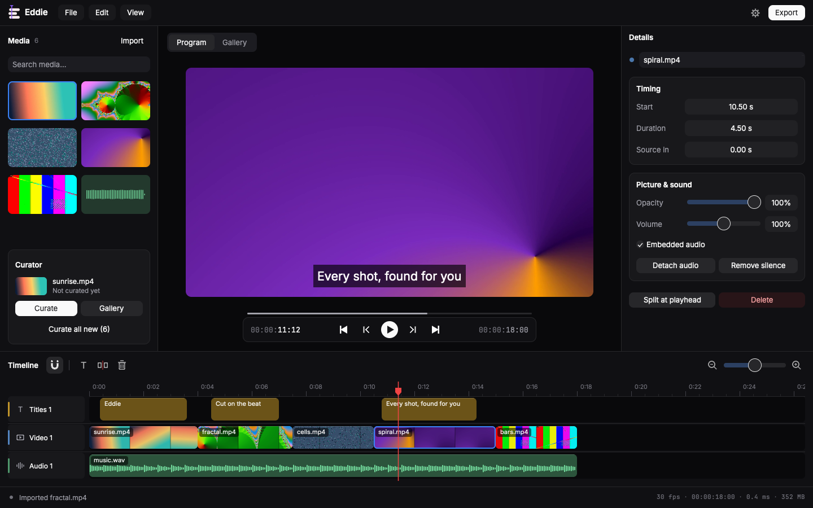

# Eddie

*The editor that watches the footage for you.*

[](https://github.com/BurgessTG/eddie/actions/workflows/ci.yml)

A fast desktop video editor that AI agents can drive. Rust end to end:
[Rune](https://github.com/anomalyco/rune) on `wgpu` for the UI, in-process
FFmpeg (`ffmpeg-next`) for probing and playback, and the `ffmpeg` command
for export.

Import footage, let the curator break it into every shot with its
transcript, then cut those ranges together on a free-form timeline and
export an H.264/AAC MP4. There is no AI inside: any agent (Claude Code,
Codex, Amp, your own script) edits through the `eddie` command line and a
sandboxed JavaScript API, and you keep editing by hand in the window. See
[docs/agents.md](docs/agents.md).



Eddie runs on Linux (Wayland and X11) and on macOS on Apple Silicon. On
macOS it builds as `Eddie.app` with FFmpeg inside (see
[macOS app](#macos-app)); it has only been run in virtual machines (macOS
15.7 and 27.2). Intel Macs and Windows are not tested.

## Features

**Editor**

- Media bin: a grid of thumbnails and waveforms. Drag and drop, File →
  Import media, or pass file paths on the command line. Imports show a
  placeholder immediately.
- Timeline with separate lanes for titles, video and sound, gaps allowed;
  dragging a clip past the first or last lane of its kind creates another.
  Move, trim, split, swap adjacent clips and move clips between lanes of
  their kind. The magnet snaps edges while dragging.
- Landscape or portrait projects (Settings → Format). Video of the other
  orientation can't be placed.
- Linked audio: detach a video's sound into a clip that moves, trims and
  splits with it, or unlink it for J/L cuts. Audio clips have fades and
  can duck under speech.
- Program monitor with frame stepping. Audio drives the playhead, and the
  next cut's first picture is prerolled so short clips play through.
- Titles and generated captions in five styles, identical in preview and
  export. Remove silence tightens pauses out of speech.
- Undo/redo covers every timeline edit, whether made by hand, in Details
  or in the console.
- Projects (`.eddie`) store the timeline and media paths. Footage moved
  with its project is found again; anything else is relinked with File →
  Locate missing media.
- Export to H.264/AAC MP4 in limited-range BT.709, normalized to -16 LUFS.

**Curator**

Select a video and press **Curate**. Curation never runs on import, and
results are saved per file. It runs on this computer:

- Every frame is checked for scene cuts, with flashes, objects passing the
  lens and lighting changes rejected. You get a complete list of shots
  plus ranked suggestions.
- Speech is transcribed with the provider in Settings → Speech (local
  whisper by default) and grouped into utterances, so cuts can keep
  complete thoughts.
- Every range gets a category (`reaction`, `talking`, `action`, `broll`,
  `establishing`), tags and quality scores, all measured, not judged.
- **Gallery:** search names, tags and transcripts; filter by type, quality
  and duration. **Add shown** appends exactly what is displayed. **All
  scenes** shows every shot.

**Scripting**

- The JS console (View → JS console) runs QuickJS with memory and time
  limits and no filesystem or OS access. Run `help()` for the API.
- `eddie run` runs the same API from the command line as one edit that
  rolls back completely if any part fails.

## Requirements

- Rust, pinned in `mise.toml` (use [mise](https://mise.jdx.dev)).
- Build: FFmpeg 9, ALSA and GTK 3 development files, `pkg-config`, `clang`
  (for bindgen), `cmake` and a C++ compiler (for whisper.cpp). On Arch:
  `sudo pacman -S --needed base-devel clang cmake pkgconf ffmpeg alsa-lib gtk3 fontconfig`.
- Runtime: `ffmpeg` 9 on `PATH`; ALSA (or PipeWire/Pulse through ALSA) for
  sound; GTK 3 for file dialogs; fontconfig (`fc-match`) and a font for
  titles; a Vulkan driver for the window. The tests also need `ffprobe`.
- macOS, to build and run from a checkout: Xcode's command line tools and
  `brew install pkgconf cmake ffmpeg ffmpeg-full`. The build links the
  FFmpeg libraries Homebrew has linked, which after that command are
  `ffmpeg-full`'s, and the built `eddie` loads them from there. Titles and
  contact sheets need the `ffmpeg` command's `drawtext` filter, which
  Homebrew's `ffmpeg` lacks and `ffmpeg-full` has; Eddie finds
  `ffmpeg-full` where Homebrew installs it. `Eddie.app` needs none of
  this to run: it carries its own FFmpeg.
- `EDDIE_FFMPEG=/path/to/ffmpeg` names the `ffmpeg` command to use, on any
  system.
- Optional: a key for a cloud transcription provider (Meta Voice
  Transcribe or any OpenAI-compatible API). Local transcription needs none.
- For transcription: a whisper.cpp model in `whisper/` beside the settings
  file (or `EDDIE_WHISPER_DIR`), from
  [ggerganov/whisper.cpp](https://huggingface.co/ggerganov/whisper.cpp).
  `ggml-large-v3-turbo.bin` (1.6 GB) is the CPU default. GPU builds (see
  [GPU transcription](#gpu-transcription)) use `ggml-large-v3.bin`
  (3.1 GB) when it fits the GPU's free memory and otherwise the best
  installed model that does; without a usable GPU they run on the CPU.
  Settings → Speech model picks one installed model by hand. Add
  `ggml-silero-v5.1.2.bin` from
  [ggml-org/whisper-vad](https://huggingface.co/ggml-org/whisper-vad) so
  music and room tone are skipped instead of misheard. `ggml-base.bin`
  times the words of turn-only cloud transcripts.

Settings live in `~/.config/eddie/config.json` on Linux,
`~/Library/Application Support/Eddie/` on macOS and `%APPDATA%\Eddie\`
on Windows. A folder from before the rename (`openreel`, `OpenReel`) is
moved there the first time Eddie starts.

## Run

```sh
git clone https://github.com/BurgessTG/eddie.git
cd eddie
mise exec -- cargo run --release                  # judge performance in release
mise exec -- cargo run --release -- a.mp4 b.mov   # import files on launch
SDL_AUDIODRIVER=dummy mise exec -- cargo test --workspace   # full suite, headless
mise exec -- cargo run -p openreel-media --example generate_samples -- samples
```

The last command generates test media into `samples/`. CI checks
formatting, then builds and tests the whole workspace in an Arch Linux
container, which has FFmpeg 9.

Open Settings with the gear beside Export (Ctrl+,) for hardware decode
(VAAPI on Linux, VideoToolbox on macOS, off by default), the speech
provider, its model and the project format.

### macOS app

```sh
brew install pkgconf cmake meson ninja   # once; Rust and Xcode's command line tools too
packaging/macos/bundle.sh                # builds target/release/Eddie.app
open target/release/Eddie.app
```

`Eddie.app` opens from Finder and shows its own icon there and in the
Dock. Double-clicking a `.eddie` project opens it in Eddie, and media
opened with Eddie (Open With, `open -a Eddie clip.mp4`) is imported. The
command line is inside the app: `Eddie.app/Contents/MacOS/eddie`.

FFmpeg is inside the app, so a Mac needs nothing else installed to run
it: no Homebrew and no `ffmpeg`. The script builds FFmpeg 9.0.2 from
source for it (`packaging/macos/ffmpeg.sh`; the first build downloads the
sources) with x264, FreeType, HarfBuzz, dav1d and LAME. The app is about
52 MB, carries seven libraries and asks for macOS 11.0 or later on Apple
Silicon. It reads what FFmpeg decodes itself (H.264, HEVC, ProRes, VP9
and the rest) and AV1 through dav1d, and exports H.264 with AAC.

This was checked on two machines, each running the copy it built: a
virtual machine on macOS 15.7 with Homebrew and the checkout moved away,
and a MacBook Air M1 on macOS 26.6 from `/Applications`. Every command
and an export worked on both, and the window opened and played with
nothing loaded from Homebrew. A copy has not yet been carried to a Mac
that did not build it, and it has not run on macOS 11 to 14.

That FFmpeg is built with `--enable-gpl` for x264, so it is under the GPL
version 2 or later, and passing the app on means meeting that licence,
which includes offering the source of FFmpeg and of those libraries.
Their licences are in `Eddie.app/Contents/Resources/licenses`, with
`SOURCES.txt` naming where each source came from. Eddie's own code stays
MIT or Apache-2.0.

Without a signing identity the app is signed ad hoc: it runs on the Mac
that built it, and a copy downloaded from elsewhere gets the Gatekeeper
warning. An app for other people is signed with a Developer ID and
notarized by Apple:

```sh
EDDIE_SIGN_IDENTITY="Developer ID Application: Name (TEAM)" packaging/macos/bundle.sh
packaging/macos/notarize.sh              # writes Eddie-<version>-macos-arm64.zip
```

`notarize.sh` reads Apple's credentials from the keychain profile
`eddie-notary`; its first lines say how to store it. Both ran on macOS
26.6 with Xcode 26.6: Apple accepted the app, which needs no
entitlements, and Gatekeeper reports it as a notarized Developer ID app.

### GPU transcription

On Linux, local transcription runs on the CPU unless Eddie is built with a
GPU feature. On Apple Silicon every build uses Metal. `eddie --version`
says which build you have.

```sh
mise exec -- cargo build --release -p openreel-app --features vulkan   # any GPU with a Vulkan driver
mise exec -- cargo build --release -p openreel-app --features cuda     # NVIDIA, needs the CUDA toolkit
```

- `vulkan` needs `vulkan-headers` and `shaderc` to build. The binary links
  only `libvulkan`, which the window already uses, and it transcribes on
  the CPU where no GPU is usable. The packages are built this way.
- `cuda` is faster on NVIDIA cards: 45 s of speech with large-v3 on an RTX
  2070 SUPER took 4.9 s, and 7.1 s with Vulkan (separate sessions). The
  binary does not start without the CUDA libraries.

### Install on Arch

`packaging/aur-git/PKGBUILD` builds the latest `master` as `eddie-git`. It
installs `eddie`, a desktop entry that opens `.eddie` projects, the icon
and these docs:

```sh
mkdir -p /tmp/eddie-pkg && cp packaging/aur-git/PKGBUILD /tmp/eddie-pkg/ && cd /tmp/eddie-pkg
makepkg -si
```

The AUR has `eddie` and `eddie-git`. `eddie` is release 0.1.0, the editor
from before the command line described below, and both packages wait for
0.2.0 to be updated. Until then, build from this repository.
[packaging/README.md](packaging/README.md) says how a release is cut.

## Command line

Agents and scripts drive Eddie from the command line. Each command does
one thing to a project and prints one JSON object; errors print
`{"ok":false,"error":...}` and exit 1. Without a running editor, a command
opens the project file, acts, and saves if it changed the project.

```sh
eddie new talk.eddie footage/*.mp4 music.wav    # create, importing media
eddie import talk.eddie more.mov                # add to the bin
eddie state talk.eddie                          # the JSON scripts see
eddie inspect talk.eddie                        # measured timeline problems
eddie run talk.eddie -e "addAssetRange('a.mp4', 0, 12.5, 4)"
eddie run talk.eddie edit.js --dry-run          # report without saving
eddie curate talk.eddie                         # shots and ranked ranges
eddie sheet talk.eddie sheet.jpg                # the edit as labelled pictures
eddie strip talk.eddie a.mp4 a.jpg              # 16 pictures through a source
eddie frames talk.eddie a.mp4 12..14 shots/     # timestamped source frames
eddie export talk.eddie out.mp4
eddie help                                      # commands and the script API
eddie guide                                     # the guide for agents
eddie --version                                 # the version and its transcription backend
```

`eddie transcribe talk.eddie [asset...]` transcribes media with the
provider in Settings (Speech): **Local** whisper by default, needing no key,
or **Meta Voice Transcribe**, or any **OpenAI-compatible**
`/audio/transcriptions` endpoint (OpenAI, Groq, a local server). Override
with `--provider local|meta|openai`, `--model`, `--language`,
`--vocabulary "Eddie, Bothell"` (names to spell right; optional, it can
also make other words worse), and `EDDIE_TRANSCRIBE_API_KEY`. Transcripts are saved per file, so a file is
transcribed once unless you pass `--force`; Curate uses the same ones.

`run` uses the same JavaScript API as the in-app console (View → JS
console), as one edit: every command applies, or none does. It prints the
script's `return` value, `console.log` lines, the clip IDs its handles
became, and the inspection findings the edit introduced.

**Live editing.** While a project is open in the Eddie window, the same
commands go to that window instead of the file: an agent's edits appear on
the timeline as you watch, each `run` is one step in your Undo history, and
the window still saves only when you do (or on `eddie save`). `eddie serve
talk.eddie` keeps a project open without a window, so media stays loaded
between commands (about 50 ms each instead of about a second) and every
change is saved; `eddie stop` ends it. `eddie undo` and `eddie redo` step
the running editor's history, and `eddie events` prints one JSON line per
change. The editor listens on a Unix socket only your user can open, under
`$XDG_RUNTIME_DIR/eddie` (or `run/` beside the settings file); the
protocol is in [docs/agents.md](docs/agents.md).

`sheet`, `strip` and `frames` let an agent that cannot watch video look at
its work. A sheet shows one labelled cell per visible shot (16 at most; a
timeline range such as `10..25` shows one part in full). A strip shows a
whole source and marks what the timeline already uses. Frames are JPEGs
named by their source time, 40 per call at most.

[docs/agents.md](docs/agents.md) is the guide for agents: the API, the
time grammar, and the rules that keep edits from going wrong.

## Shortcuts

Press F1 or Ctrl+/ in the app for the full list. Cmd replaces Ctrl on
macOS.

| Key | Action |
| --- | --- |
| Space | Play / pause |
| ← / → | Step one frame (Shift: one second) |
| ↑ / ↓ | Previous / next cut |
| Home / End | Go to start / end |
| S or B | Split at the playhead |
| T | Add title |
| M | Toggle magnet |
| Delete | Delete the selected clip |
| Ctrl+Z / Ctrl+Shift+Z | Undo / redo |
| Ctrl+= / Ctrl+- / Shift+Z | Zoom in / out / fit timeline |
| Ctrl+N / O / S | New / open / save project |
| Ctrl+I / Ctrl+E | Import media / export MP4 |
| Ctrl+, | Settings |

## Layout

| Crate | Role |
| --- | --- |
| `crates/engine` (`openreel-engine`) | UI-independent timeline model: lanes, linked clips, edits, titles, timecode. |
| `crates/media` (`openreel-media`) | FFmpeg: probe, native decode and preview, audio mixer, scene detection, waveforms, thumbnails, export. |
| `crates/core` (`eddie-core`) | The editor without a window: media bin, project, playback, undo, curation, transcription, the QuickJS scripting API and the `eddie` command line. |
| `crates/app` (`openreel-app`, binary `eddie`) | The window over `eddie-core`, drawn with [Rune](https://github.com/anomalyco/rune): media bin, timeline, monitor, gallery, curator, settings. |

## Limitations

- Local whisper does not label speakers; Meta's transcription does.
  Proper nouns it can't know (product names) may be misspelled.
- Meta's ASR returns speaker turns only. Without `ggml-base.bin`, its
  speech edges are turn-level.
- Burned-in text (title cards, news bars) is not detected, so curation
  can't exclude it. Curations saved by the removed model reviewer keep
  their `on-screen-text` tags.
- Curator scores and categories are measurements (motion, sound, speech),
  not editorial judgment. That judgment is the agent's or yours.
- Undo history is not saved with a project.
- Sound-card output latency is not compensated.

## Contributing

[CONTRIBUTING.md](CONTRIBUTING.md) covers building, tests and the rules the
code follows. Report a vulnerability as [SECURITY.md](SECURITY.md) says.
[CHANGELOG.md](CHANGELOG.md) lists what each release changed.

## License

Licensed under either of [Apache License, Version 2.0](LICENSE-APACHE) or
[MIT license](LICENSE-MIT) at your option.

Unless you explicitly state otherwise, any contribution intentionally
submitted for inclusion in this work, as defined in the Apache-2.0 license,
shall be dual licensed as above, without any additional terms or conditions.
